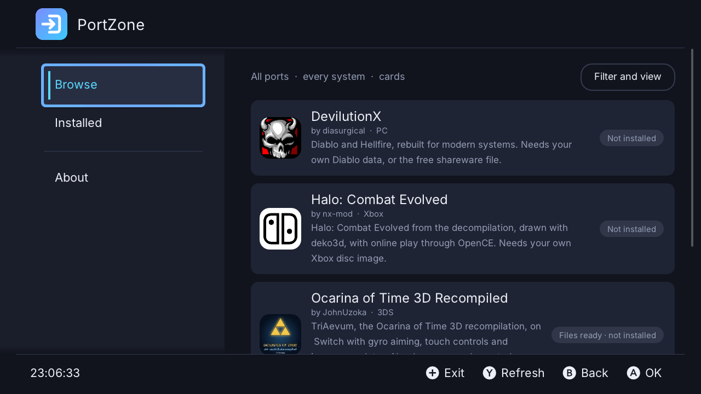
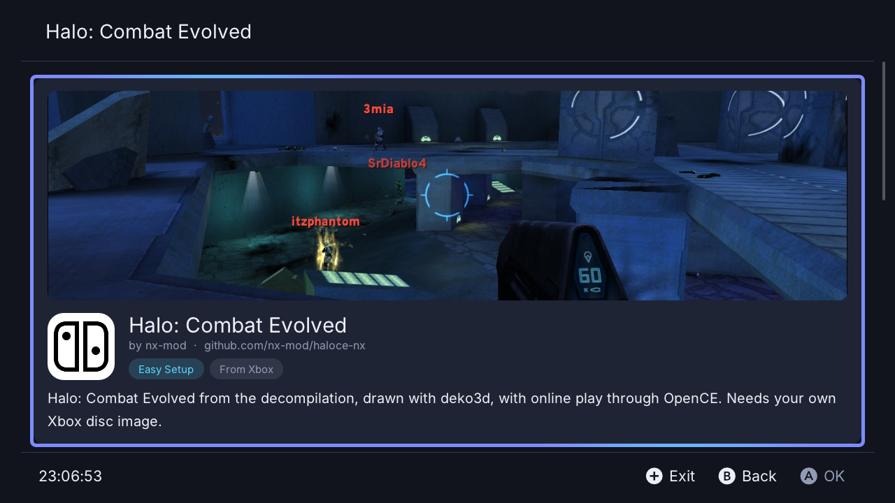

# PortZone

A Switch homebrew app for GitHub game projects that need your own game files. It lists the ports in this repository's
[store](store/), installs and updates them from their GitHub releases, and puts your game files where each one needs
them, sent from a phone or PC or found on the SD card.

  
  

- **Players**: copy `portzone.nro` from the [releases](https://github.com/JohnUzoka/portzone-nx/releases) to
  `switch/` on your SD card. How it works: [docs/using.md](docs/using.md).
- **Porters**: your port is probably already listed. Add a `portzone.json` to your repository for one-button installs,
  a checklist of the player's files and automatic file placement: [docs/portzone-json.md](docs/portzone-json.md).
- **Adding a port to the store**: [CONTRIBUTING.md](CONTRIBUTING.md).
- **Building and code**: [docs/development.md](docs/development.md).

## Legal

GPL-3.0 ([LICENSE](LICENSE)). Uses borealis (Apache-2.0), nlohmann/json, miniz and PicoSHA2 (MIT) and the Inter font
(OFL), each under its own license in its folder.

PortZone is an independent project, not affiliated with or endorsed by any console maker or game publisher. Names of
games and systems only say what a project is for and belong to their owners. PortZone and its store contain no game
data, keys or firmware, link to none, and give no instructions for getting around copy protection: every project
listed asks for files the player already owns.
